<a name="readme-top"></a>

<!-- PROJECT SHIELDS -->
[](https://github.com/wantedProgrammer/fantasy-football-predictor/graphs/contributors)
[](https://github.com/wantedProgrammer/fantasy-football-predictor/network/members)
[](https://github.com/wantedProgrammer/fantasy-football-predictor/stargazers)
[](https://github.com/wantedProgrammer/fantasy-football-predictor/issues)
[](https://github.com/wantedProgrammer/fantasy-football-predictor/blob/main/LICENSE)


<!-- PROJECT LOGO -->
<br />
<div align="center">
  <a href="https://github.com/wantedProgrammer/fantasy-football-predictor">
    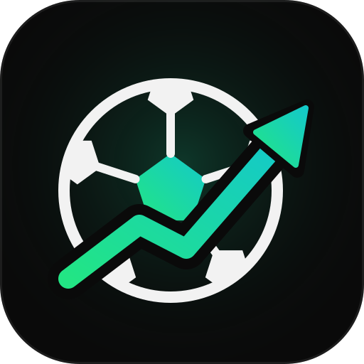
  </a>

  <h3 align="center">Fantasy Predictor</h3>

  <p align="center">
    The best Fantasy Premier League and Champions League Fantasy team, every gameweek.
    <br />
    <a href="#getting-started"><strong>Get started »</strong></a>
    <br />
    <br />
    <a href="#usage">View Screenshots</a>
    ·
    <a href="https://github.com/wantedProgrammer/fantasy-football-predictor/issues">Report Bug</a>
    ·
    <a href="https://github.com/wantedProgrammer/fantasy-football-predictor/issues">Request Feature</a>
  </p>
</div>


<!-- TABLE OF CONTENTS -->
<details>
  <summary>Table of Contents</summary>
  <ol>
    <li>
      <a href="#about-the-project">About The Project</a>
      <ul>
        <li><a href="#features">Features</a></li>
        <li><a href="#how-the-predictions-work">How the Predictions Work</a></li>
        <li><a href="#built-with">Built With</a></li>
      </ul>
    </li>
    <li>
      <a href="#getting-started">Getting Started</a>
      <ul>
        <li><a href="#prerequisites">Prerequisites</a></li>
        <li><a href="#installation">Installation</a></li>
        <li><a href="#configuration">Configuration</a></li>
      </ul>
    </li>
    <li><a href="#usage">Usage</a></li>
    <li><a href="#graphql-api">GraphQL API</a></li>
    <li><a href="#data-sources">Data Sources</a></li>
    <li><a href="#tests-and-builds">Tests and Builds</a></li>
    <li><a href="#project-structure">Project Structure</a></li>
    <li><a href="#roadmap">Roadmap</a></li>
    <li><a href="#contributing">Contributing</a></li>
    <li><a href="#license">License</a></li>
    <li><a href="#contact">Contact</a></li>
    <li><a href="#acknowledgments">Acknowledgments</a></li>
  </ol>
</details>


<!-- ABOUT THE PROJECT -->
## About The Project

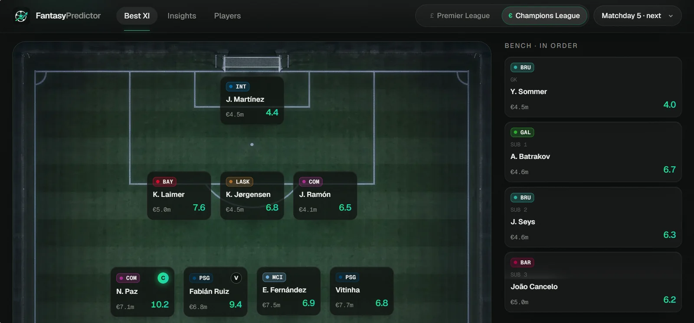

Fantasy Predictor picks the best Fantasy Premier League (FPL) and UEFA Champions League Fantasy teams for every gameweek. It also gives analytics and tips built from the official fantasy APIs.

For each upcoming gameweek it projects expected points for every player, builds the highest-scoring legal 15-player squad with a starting XI and captain, and surfaces captain picks, differentials, value picks, injury news, transfer trends and a fixture-difficulty ticker, along with tips written from that week's data.

The site is free and public: there is no sign-up or login, and no personal data is stored.

### Features

* ⚽ **Best XI:** the optimal squad for any upcoming gameweek in either competition, shown on a pitch with captain, vice-captain, bench order, squad cost and money in the bank
* 🗓️ **Plan for:** optimise for 1 gameweek (like a Free Hit), 3 gameweeks, or 5 gameweeks (like a Wildcard)
* 📏 **Real game rules:** £/€100m budget, 2 GK / 5 DEF / 5 MID / 3 FWD, at most 3 players per club, and legal formations
* 🔍 **Why this pick:** click any player to see their fixture, form, xGI, clean-sheet chance and availability
* 💡 **Insights:** generated tips for the deadline, captaincy, double and blank gameweeks, fixture runs, injuries, differentials, value and transfers
* 📊 **Analytics:** captain shortlist, differentials (under 10% owned), best value (points per million), in-form players, injury watch and transfer trends
* 🎨 **Fixture ticker:** the next 5 gameweeks for every team, colour-coded by difficulty
* 🧑‍🤝‍🧑 **Players:** every player with price, next-gameweek projection, points, form, ownership and injury news; search, filter, sort, shuffle and star favourites (saved in your browser, per competition)
* 🏆 **Two competitions:** switch between Premier League (£) and Champions League (€) at any time

<p align="right">(<a href="#readme-top">back to top</a>)</p>


### How the Predictions Work

#### Projection model (`backend/src/Predictor/projection.ts`)

For each fixture, a player's expected points combine two views of the data:

1. **Event model:** 2 points for an appearance, plus expected goal and assist points. These use xG and xA per 90 minutes when FPL provides them, and goals and assists adjusted for small samples otherwise. The total is scaled by how many goals the opponent concedes and by home advantage. Clean-sheet points use a Poisson estimate of goals conceded. Goalkeepers also get save points, and every player gets their average bonus.
2. **Track-record model:** points per appearance blended with recent form, then scaled by fixture difficulty (1–5).

The result is multiplied by the chance the player is available (from injury and suspension status) and the chance they start (starts or minutes compared with their team's games played). Double gameweeks add up both fixtures, and blank gameweeks score zero.

Team attack and defence ratings come from finished results and are pulled towards the league average, so a handful of games doesn't dominate. For the next FPL gameweek, 20% of the projection comes from FPL's own `ep_next` figure.

#### Squad optimiser (`backend/src/Predictor/optimizer.ts`)

The optimiser runs a local search from two starting squads: the cheapest legal squad, and a greedy squad that keeps enough budget to fill every slot. It repeatedly makes the best single-player swap. When no single swap helps, it tries two-player swaps, so a downgrade can pay for an upgrade elsewhere. The score is the best XI's points with the captain counted twice, plus 10% of the bench's points. The best formation is chosen for each squad.

_These are statistical estimates, not guarantees. Team news, rotation and luck still matter._

<p align="right">(<a href="#readme-top">back to top</a>)</p>


### Built With

* [](https://www.typescriptlang.org/)
* [](https://nodejs.org/)
* [](https://nestjs.com/)
* [](https://graphql.org/)
* [](https://www.apollographql.com/)
* [](https://react.dev/)
* [](https://vite.dev/)
* [](https://tailwindcss.com/)
* [](https://reactrouter.com/)

Also using Axios for the fantasy API clients.

<p align="right">(<a href="#readme-top">back to top</a>)</p>


<!-- GETTING STARTED -->
## Getting Started

To get a local copy up and running, follow these steps.

### Prerequisites

* Node.js **20.19+ or 22.12+** (Vite 8 needs this; Node 24 works)
* npm

No database or API keys are needed. All data comes from the public fantasy APIs.

### Installation

1. Clone the repo
   ```sh
   git clone https://github.com/wantedProgrammer/fantasy-football-predictor.git
   cd fantasy-football-predictor
   ```
2. Start the backend (runs on http://localhost:4000/graphql)
   ```sh
   cd backend
   npm ci
   npm run start
   ```
3. Start the frontend in a second terminal (runs on http://localhost:5173)
   ```sh
   cd frontend
   npm ci
   npm run dev
   ```
4. Open [http://localhost:5173](http://localhost:5173). You'll land on the Best XI page.

### Configuration

All variables are optional.

| Variable | Where | Default | Purpose |
| --- | --- | --- | --- |
| `PORT` | backend | `4000` | HTTP port |
| `CORS_ORIGIN` | backend | `http://localhost:5173` | Comma-separated list of allowed frontend origins |
| `UCL_SEASON_ID` | backend | auto-detected | Forces a specific UEFA fantasy season |
| `VITE_API_URL` | frontend | `http://localhost:4000/graphql` | GraphQL endpoint the frontend calls |

<p align="right">(<a href="#readme-top">back to top</a>)</p>


<!-- USAGE EXAMPLES -->
## Usage

| Best XI | Captain and bench |
| --- | --- |
| 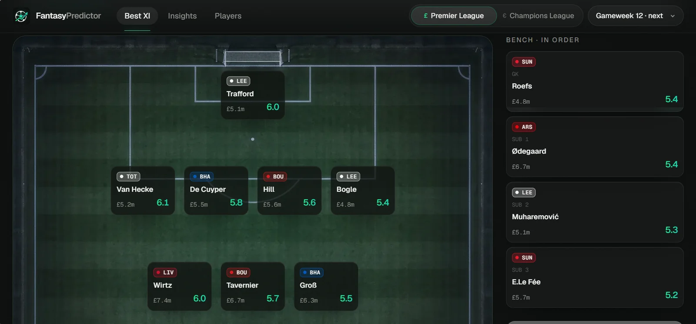 | 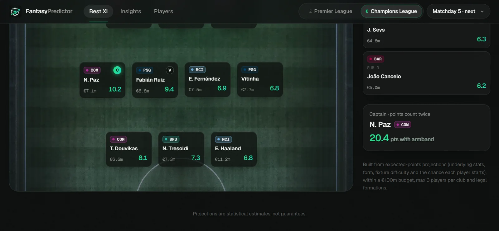 |

| Insights | Captain, differentials and value |
| --- | --- |
| 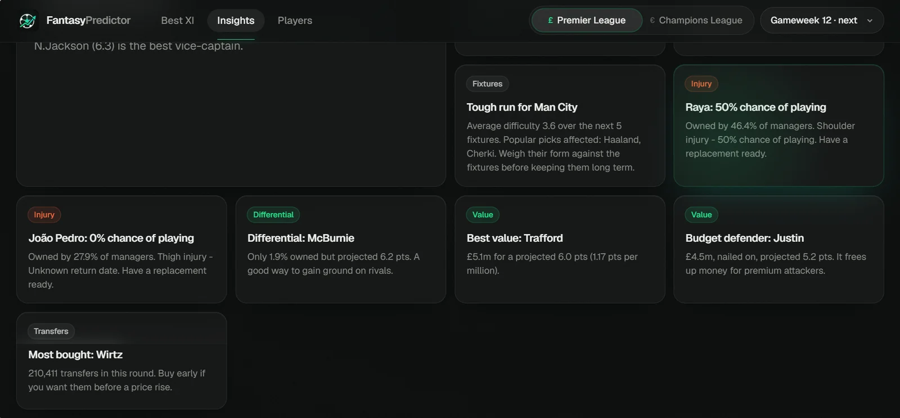 | 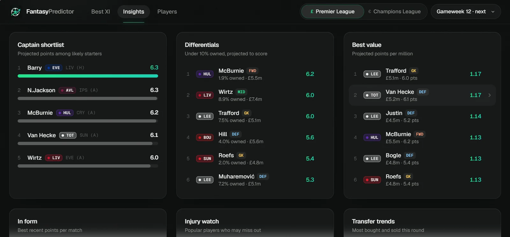 |

| Form, injuries and transfers | Fixture ticker |
| --- | --- |
| 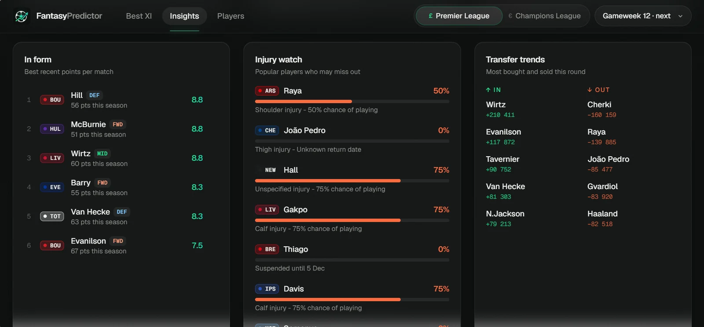 | 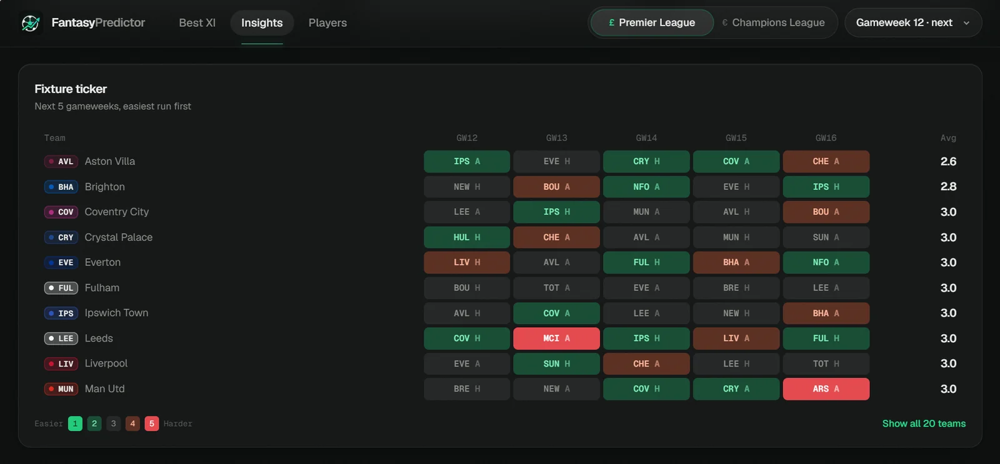 |

| Players | Champions League |
| --- | --- |
| 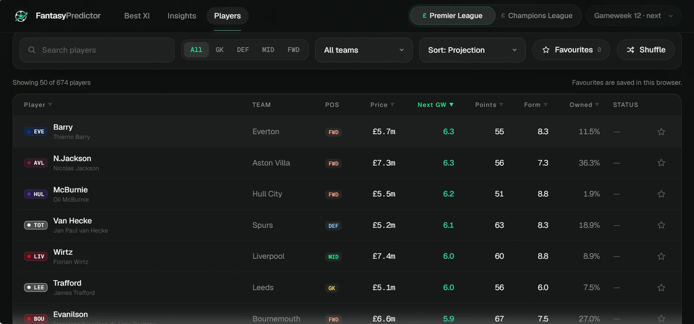 | 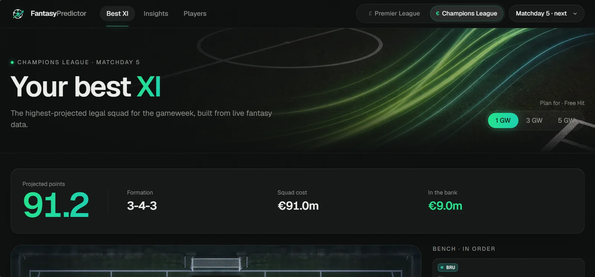 |

<details>
<summary>More screenshots</summary>

| Best XI (Premier League) | Insights (Premier League) |
| --- | --- |
| 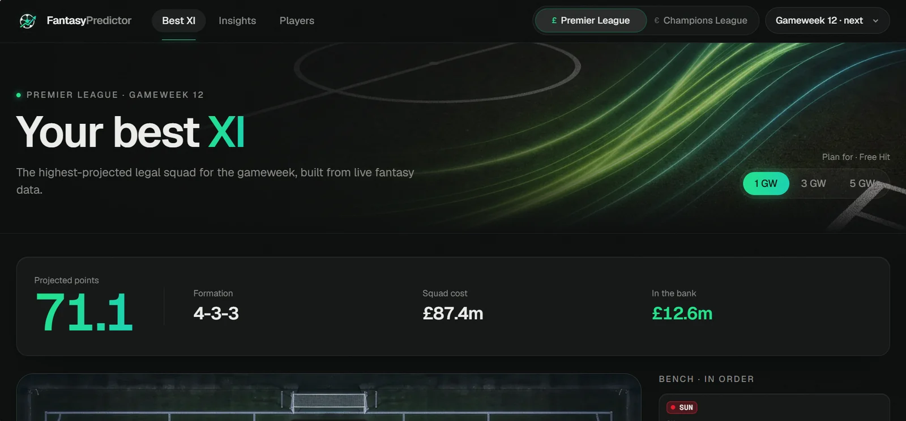 | 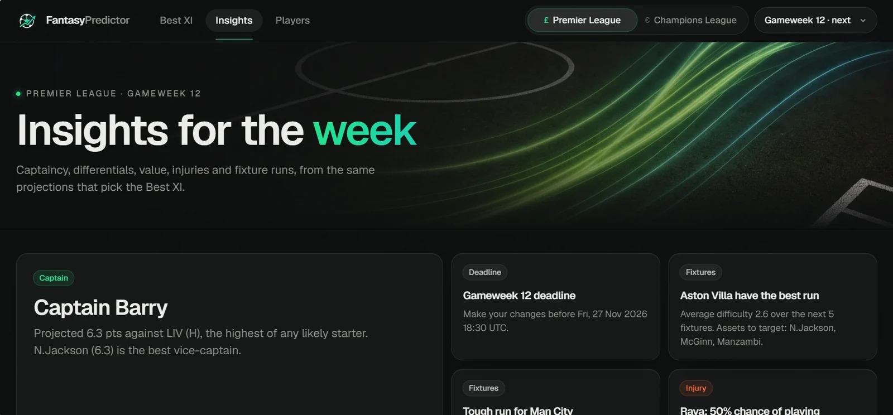 |

| Players (Premier League) | Players (Champions League) |
| --- | --- |
| 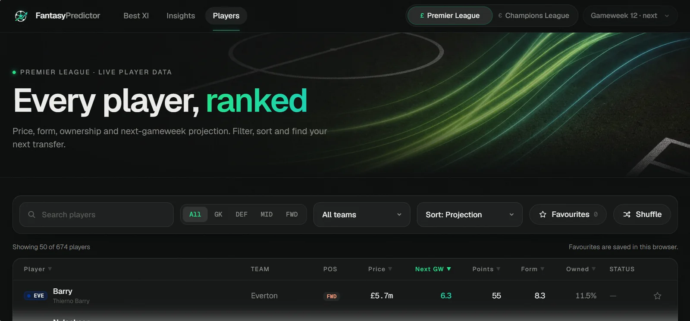 | 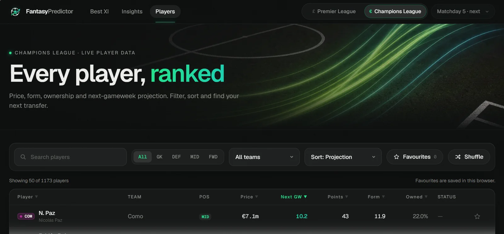 |

| Insights (Champions League) | Tips (Champions League) |
| --- | --- |
|  | 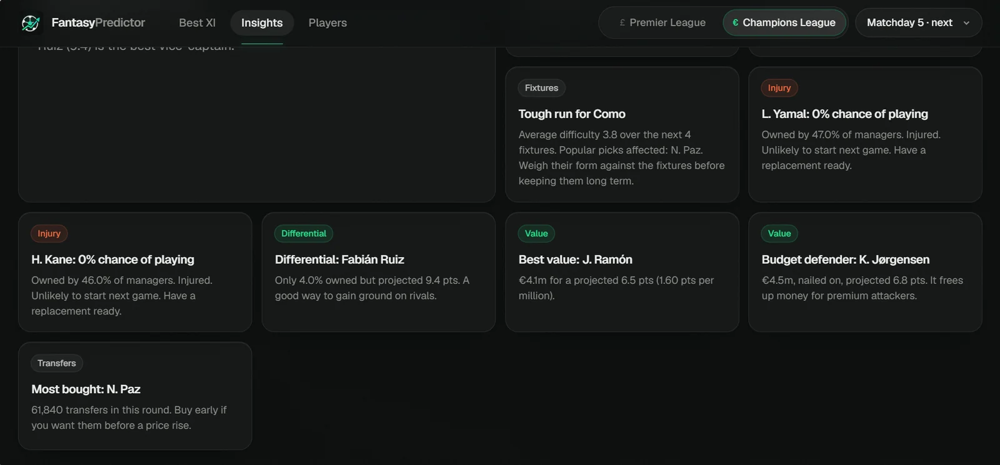 |

| Captain, differentials and value (Champions League) | Form, injuries and transfers (Champions League) |
| --- | --- |
| 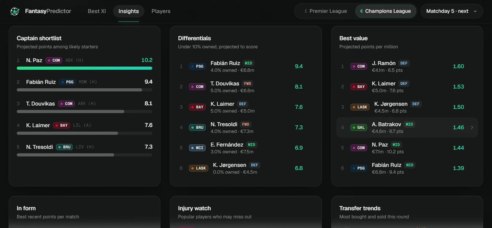 | 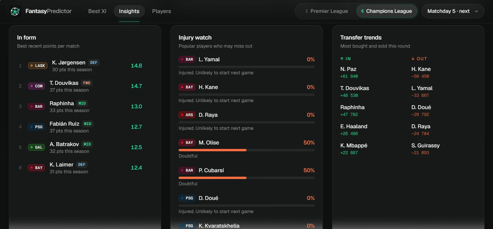 |

| Fixture ticker (Champions League) | |
| --- | --- |
| 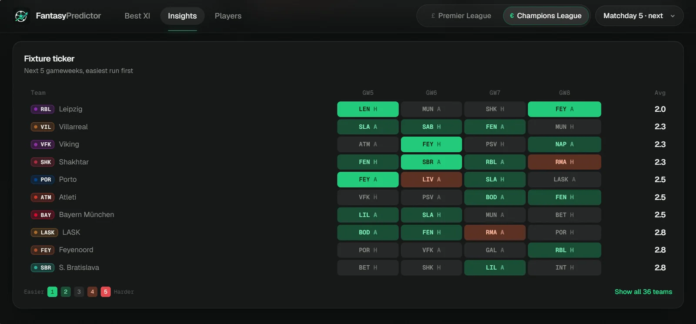 | |

</details>

<p align="right">(<a href="#readme-top">back to top</a>)</p>


<!-- GRAPHQL API -->
## GraphQL API

All queries are public; no token is needed.

```graphql
# Season rules and gameweeks
query { season(league: PREMIER_LEAGUE) { currency budget defaultGameweek gameweeks { id name deadline isNext } } }

# Best squad (gameweek defaults to the next one; horizon 1–5)
query {
  predictedTeam(league: CHAMPIONS_LEAGUE, horizon: 3) {
    gameweekName formation totalCost bank predictedPoints
    starters { isCaptain predictedPoints reasons player { displayName teamShort position price } }
    bench { player { displayName } predictedPoints }
  }
}

# Analytics and tips
query {
  insights(league: PREMIER_LEAGUE) {
    tips { category title body }
    captainPicks { predictedPoints player { displayName } }
    fixtureTicker { team averageDifficulty fixtures { gameweek opponent home difficulty } }
  }
}

# All players with next-gameweek projections
query { players(league: PREMIER_LEAGUE) { displayName team position price predictedPoints } }

# Recent points per gameweek for one player (FPL only; used for form sparklines)
query { playerHistory(league: PREMIER_LEAGUE, playerId: "430") { recent { gameweek points } } }
```

<p align="right">(<a href="#readme-top">back to top</a>)</p>


<!-- DATA SOURCES -->
## Data Sources

| Competition | Endpoints |
| --- | --- |
| Premier League | `https://fantasy.premierleague.com/api/bootstrap-static/` and `/api/fixtures/` |
| Champions League | `https://gaming.uefa.com/en/uclfantasy/services/feeds/fixtures/fixtures_{season}_en.json` and `.../players/players_{season}_en_{matchday}.json` |

* API responses are cached in memory for 10 minutes.
* UEFA numbers each season (80 = 2025/26, 90 = 2026/27). The backend picks the newest season with a published fixture feed, so it keeps working when a new season starts. Set `UCL_SEASON_ID` to force a particular season.
* The UEFA feeds are not documented public APIs, so their format or availability may change.

<p align="right">(<a href="#readme-top">back to top</a>)</p>


<!-- TESTS AND BUILDS -->
## Tests and Builds

```sh
cd backend
npm test          # unit tests for the projection model, optimiser, services and resolvers
npm run build

cd ../frontend
npm run lint
npm run build
```

<p align="right">(<a href="#readme-top">back to top</a>)</p>


<!-- PROJECT STRUCTURE -->
## Project Structure

```text
backend/src/
├── App/          # Root module (GraphQL)
├── Players/      # API clients (FPL, UEFA), normalised domain model, players and history queries
└── Predictor/    # Projection model, squad optimiser, insights, GraphQL resolver

frontend/src/
├── components/   # Layout, motion and UI building blocks, player panel, states
├── graphql/      # Queries
├── lib/          # League context, favourites, formatting helpers
└── pages/        # Team (Best XI), Insights, Players
```

<p align="right">(<a href="#readme-top">back to top</a>)</p>


<!-- ROADMAP -->
## Roadmap

- [x] Premier League projections and Best XI
- [x] Champions League Fantasy support
- [x] Multi-gameweek planning (Free Hit, 3 GW, Wildcard)
- [x] Insights, fixture ticker and generated tips
- [x] Players table with search, filters and favourites
- [ ] Deploy a public live demo
- [ ] Import your own FPL team and get transfer suggestions
- [ ] Chip strategy (Bench Boost, Triple Captain)
- [ ] Track projection accuracy against actual points

See the [open issues](https://github.com/wantedProgrammer/fantasy-football-predictor/issues) for a full list of proposed features (and known issues).

<p align="right">(<a href="#readme-top">back to top</a>)</p>


<!-- CONTRIBUTING -->
## Contributing

Contributions are welcome, and improvements to the projection model are especially appreciated.

If you have a suggestion that would make this better, please fork the repo and create a pull request. You can also simply open an issue with the tag "enhancement".

1. Fork the Project
2. Create your Feature Branch (`git checkout -b feature/AmazingFeature`)
3. Commit your Changes (`git commit -m 'Add some AmazingFeature'`)
4. Push to the Branch (`git push origin feature/AmazingFeature`)
5. Open a Pull Request

<p align="right">(<a href="#readme-top">back to top</a>)</p>


<!-- LICENSE -->
## License

Distributed under the MIT License. See `LICENSE` for more information.

This project is not affiliated with or endorsed by the Premier League or UEFA.

<p align="right">(<a href="#readme-top">back to top</a>)</p>


<!-- CONTACT -->
## Contact

GitHub: [@wantedProgrammer](https://github.com/wantedProgrammer)

Project Link: [https://github.com/wantedProgrammer/fantasy-football-predictor](https://github.com/wantedProgrammer/fantasy-football-predictor)

<p align="right">(<a href="#readme-top">back to top</a>)</p>


<!-- ACKNOWLEDGMENTS -->
## Acknowledgments

* [Fantasy Premier League](https://fantasy.premierleague.com/)
* [UEFA Champions League Fantasy](https://gaming.uefa.com/en/uclfantasy)
* [NestJS](https://nestjs.com/)
* [Apollo GraphQL](https://www.apollographql.com/)
* [Img Shields](https://shields.io)
* [Best-README-Template](https://github.com/othneildrew/Best-README-Template)

<p align="right">(<a href="#readme-top">back to top</a>)</p>
